# ECE 212 Project 2 - Enigma Machine - Fall 2026

## Before You Start

Download this repository by opening a terminal or PowerShell, navigating to the directory where you want to put this repository, and then running:
```
git clone https://github.com/DougTownsend/ece212-project2.git
```

In order for this project to work on the Pico, you will need to update Apio. Assuming you followed the instructions [here](https://github.com/DougTownsend/apio/blob/main/README.md), open a terminal or PowerShell and run:
```
cd ~/apio
git pull origin main
pipx install --force .
```

## Background

The Enigma machine was used by the Germans during World War II to encrypt their radio communications. At its core, the machine is a “reciprocal cipher,” which means that entering the plain text into the machine outputs the cipher text, and entering the cipher text into the machine outputs the plain text. Reciprocal ciphers on their own are quite easy to break, so the Enigma machine changed ciphers after each keypress. This was accomplished by rotors that would change the internal wiring, in a repeatable way, each time a key was pressed. This is what we call a "pseudorandom number generator" or "PRNG." It is initialized with an initial value called a "seed", and then produces a random-looking sequence. The sequence will always be the same for a given seed. The real Enigma machine had about 1.6*10^20 possible seeds, making it very difficult to crack with the technology of the time. Our machine will only have 256 possible seeds, since we are using our 8-position DIP switch to input the seed. Our machine will also be simpler because it will only have 4-bit inputs and outputs. For further reading on the history of the Enigma machine, see [Wikipedia](https://en.wikipedia.org/wiki/Enigma_machine).

## Provided Files and Autograding

This repository contains the directories `pico_enigma` and `fpga_enigma`. You will do your work in the directory that corresponds to the board you are using. Inside each directory there is a `test` directory, which contains all of the testbenches that the autograder will run. To run the tests, **your terminal must be in the `pico_enigma` or `fpga_enigma` directory** and then run:
```
apio sim test/<name_of_testbench>.v
```
Replace `<name_of_testbench>` with the testbench filename you want to run.

When you run a simulation, it will produce a text file that the autograder will compare against the text file produced by the solution. I have provided the solution outputs so you can check your code without waiting for the autograder to complete.

You will submit the following files to Gradescope:
```
main.v
enigma.v
negate.v
ones_comp_add.v
sbox.v
sevseg_disp.v
swap.v
xorshift798.v
```
To receive full credit, you must submit all files at the same time. However, every test except the `main.v` tests checks a single file, so you can submit them individually if you don't want to run the testbenches on your own. The tests for `main.v` require all the files.

**All the files you will modify have comments that say "Do not modify above this line"**. However, it is okay for you to change a `reg` to a `wire`, or a `wire` to a `reg`. You cannot change the names of ports, or the ordering of ports.

## Circuit Additions

For this project, you will need to wire up the switches and the seven-segment display. The updated schematic is shown below. The schematic shown is for the Pico. If you are using the FPGA, look at the `fpga_enigma/pins.pcf` file to see what pins to use. You can see a larger version of the schematic at [kicad/p2_schematic.pdf](kicad/p2_schematic.pdf).


### Switches

In this project, pressing `btn[3]` will display the 8 switch values on the 8 LEDs. You can add that to `main.v` to test your switches.

### Seven-Segment Display

Complete the module in `sevseg_disp.v`. It takes a 4-bit input which will be the value to display in hexadecimal, and a 1-bit input for the decimal point. It outputs an 8-bit signal that will go to the shift register module's `seven_seg` port. The bit ordering will be as follows, where `DP` is "Decimal Point":
```
Bit#: 7  6  5  4  3  2  1  0
Seg : DP G  F  E  D  C  B  A
```
You can see the segment naming from the datasheet of the display we are using below:


The pin numbering can be seen below. Pin 1 starts at the bottom left of the display, counts up to the right, then continues from the top right to top left, wrapping around like a U.


Here is what the display should look like for each 4-bit input:


To test your display, you can connect `sw[3:0]` to the input of the `sevseg_disp` module.

## Testing Modules

In addition to the seven-segment display module, you will implement the following modules in Verilog. Each module has one or more testbenches associated with it. The testbenches are in the `pico_enigma/test` and `fpga_enigma/test` directories. Each `test` directory has a `results` subdirectory. This contains the outputs that the autograder compares against, named something like `test_1_0_negate_soln.txt`. When you run the testbench, it will produce a file in the `results` directory named something like `test_1_0_negate.txt`. If the `*.txt` file matches the `*_soln.txt` file, your module passes that test. A Python script `test.py` will run all tests that the autograder runs, and print the results. To run the script, with a terminal in the `*_enigma` directory, run `python3 test.py` on Mac and Linux, or `python test.py` on Windows.

## Cipher

The cipher that we will be using is a combination of three reciprocal ciphers. A reciprocal cipher is a cipher where if you input `A`, and the cipher outputs `B`, then inputting `B` would output `A`. The three ciphers that we will use are:
* XOR w/ a Key
* 2's complement negation
* Substitution box

In order to have the combination of these ciphers maintain reciprocity, we need to arrange them in a symmetric way.
```
Input -> Negate -> SBox -> XOR -> SBox -> Negate -> Output
                            ^
                           Key
```

For this to work, the key for the XOR cipher cannot be zero. If the key were zero, the output would always be the same as the input. The combined cipher will go into the `enigma` module, but `negate` and `sbox` will be their own submodules.

We will also have the ability to enable and disable the `negate` and `sbox` ciphers. This gives us the equivalent of a 6-bit key for the cipher: 4 bits for the XOR key, and 1 bit each for `negate` and `sbox`. So the final cipher will look like this:
```
Input -> Negate -> SBox -> XOR -> SBox -> Negate -> Output
            ^       ^       ^       ^       ^
         neg_en  sbox_en   Key   sbox_en   neg_en
```

### Negate

In `negate.v`, implement a module that takes a 4-bit input, and a 1-bit enable, and outputs the input unchanged if enable is 0, and the 2's complement negation of the input if enable is 1.

### Substitution Box

In `sbox.v`, implement a module that takes a 4-bit input, and a 1-bit enable, and outputs the input unchanged if enable is 0, and implements the following substitutions if enable is 1 (given in decimal form):

| In | Out |
| -- | -- |
| 0 | 10 |
| 1 | 14 |
| 2 | 13 |
| 3 | 7 |
| 4 | 15 |
| 5 | 9 |
| 6 | 8 |
| 7 | 3 |
| 8 | 6 |
| 9 | 5 |
| 10 | 0 |
| 11 | 12 |
| 12 | 11 |
| 13 | 2 |
| 14 | 1 |
| 15 | 4 |

### Generating the Key and Enable signals with a PRNG

To better emulate the real Enigma machine, we will generate new keys for each 4-bit input in a repeatable way. To do this, we will use a 16-bit PRNG called Xorshift798. This is a simple PRNG that was created by John Metcalf for 16-bit processors. It operates as follows:
```
1. Start with a nonzero 16-bit seed value
2. XOR the value with itself, left shifted by 7 bits
3. XOR the result of (2) with itself, right shifted by 9 bits
4. XOR the result of (3) with itself, left shifted by 8 bits
5. The result of (4) is the pseudorandom number
6. To generate the next number, feed the result of (4) into (2)
```

For a given seed, the same sequence of 16-bit numbers will always be generated. The result is guaranteed to be nonzero. We will use these numbers to generate the XOR key, and the two enable signals.

Implement this PRNG in `xorshift798.v`. Its inputs are a 1-bit `clk` signal, a 1-bit `reset` signal, and a 16-bit `seed` signal. It outputs a 16-bit value `random`. At the positive edge of `clk`, if `reset` is high, `random` will be set to `seed`. If `reset` is low, `random` will be set to the next pseudorandom number produced by the XORs and shifts. Since the seed must be nonzero, and the switches can only input 8 bits, we will interpret a seed of 0 as 0x0100 (a 1 in bit 8, zeros elsewhere).

### Connecting the Ciphers

You will connect all the ciphers in `enigma.v`. It takes the following inputs and outputs:

| Inputs | Bits |
| --- | --- |
| `clk` | 1 |
| `reset` | 1 |
| `seed` | 8 |
| `in` | 4 |

| Outputs | Bits |
| --- | --- |
| `out` | 4 |
| `key` | 4 |

In this module you will instantiate one `xorshift798` module, two `negate` modules, two `sbox` modules, and three `ones_comp_add` modules. You will make the necessary connections by declaring `wire`s. The `clk`, `reset`, and `seed` signals will connect to their corresponding input ports on the `xorshift798` module. Since the `seed` input to the `xorshift798` module is 16 bits, while the `seed` input to the `enigma` module is 8 bits, you will need to concatenate 8 zeros to the front (upper bits) of the `seed` when connecting it to `xorshift798` like this: `{8'b0, seed}`.

The last thing that we need to do before we can start connecting the ciphers is turn the 16-bit pseudorandom number into a 4-bit nonzero key, and two enable bits. The enable bits are simple. We will just have `random[0]` be the enable signal for the `negate` modules, and `random[1]` will be the enable signal for the `sbox` modules.

For the XOR key, we need to do something a little more complicated. We need the 4-bit XOR key to be nonzero, or else the output of the cipher will be the same as the input. While the `random` number generated by `xorshift798` is guaranteed to be nonzero, there are not 4 bits within that number that are guaranteed to be nonzero. To turn the 16-bit number into a 4-bit number that is guaranteed to be nonzero, we will use ones complement addition. In ones complement addition, if the carry out of the MSB is a one, one is added to the sum. An interesting property of ones complement addition is that if any nonzero number is added to any number, the result is guaranteed to be nonzero. If the result is 0, the binary result would be `1111` which is "negative zero" in ones complement. So to turn a nonzero 16-bit value into a 4-bit nonzero value, we will do the following:

![Ones complement addition reducing random[15:0] to a 4-bit nonzero key](images/ones_comp_key.svg)

Implement the ones complement addition module in `ones_comp_add.v` and use it in `enigma`. Once that is done, you can XOR the 4-bit result with the output of the first `sbox` module, and feed the result into the second `sbox` module.

## Main Module

Now that you have the cipher complete, you can connect it all to the buttons, switches, and LEDs in the main module. You will need to instantiate your `enigma` module here. The clock input for the `enigma` module will need to come from debounced buttons. Since we want the `enigma` module to be able to be reset by only pressing the reset button, we will combine the `clk` button and `reset` button by ORing them together, and use that signal as the `clk` input. The buttons need to be debounced using `debounce` modules before ORing them. `btn[0]` will be the `clk`, and `btn[1]` will be `reset`. Use the raw (not debounced) `btn[1]` signal as the `reset` input to `enigma`.

`sw[7:0]` will be used as the `seed` input to `enigma`, and `sw[3:0]` will be used as the `in` input to `enigma`. It is okay that we are using switches 3-0 in multiple ways, since the two uses do not interfere with each other.

### LEDs

For the LEDs and the seven-segment display, we will implement the following behavior:
* If no buttons are pressed, `led[7:4]` will show the `key`, `led[3:0]` will show `in`, and `out` will be displayed on the seven-segment display.
* If `btn[2]` is pressed, it will swap where `in` and `out` are displayed. Implement the `swap` module in `swap.v` and use its outputs to drive `led[3:0]` and the input to `sevseg_disp`.
* If `btn[3]` is pressed, `led[7:0]` will display `sw[7:0]`.

## Testing with the Analog Discovery

First, you will need to download WaveForms, the software that controls the Analog Discovery. If you are on Linux, you will first need to install the Adept 2 Runtime as well.

**Linux Only:** The Adept 2 runtime can be found [here](https://digilent.com/reference/software/adept/start). Click on "Download Now" under "Linux Runtime" on the right.

**All Operating Systems:** Download WaveForms [here](https://digilent.com/reference/software/waveforms/waveforms-3/start). Digilent is very annoying, and will make you create an account to download this. Then it will take you to a different "Products" page. Search for "WaveForms" there, then click it and choose the download for your operating system. I do not know why companies do this.

Once you have WaveForms installed, open it to see the welcome screen. This is where you can open the different tools that are part of the AD3.

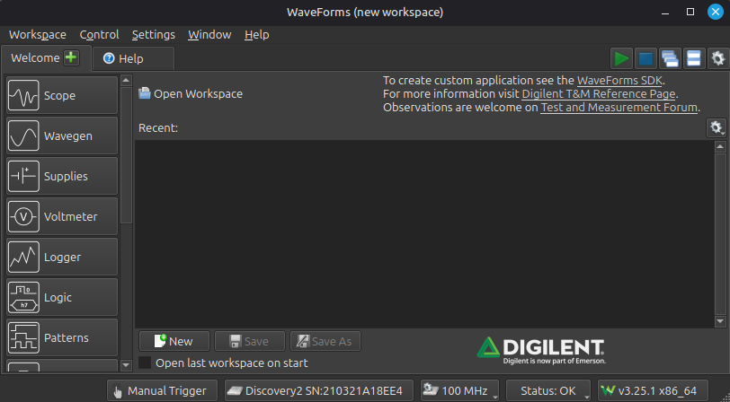

For this project, we will be using the pattern generator, waveform generator, and the logic analyzer. The pattern generator will feed the 4-bit inputs to our circuit, the waveform generator will control the clock and reset signals, and the logic analyzer will allow us to see how they change with time, similar to what we would see on the waveform viewer when we simulate with Apio.

### Connecting the AD3 to your circuit

The AD3 has 16 digital I/O pins labeled 0-15. To make it clearer, I will refer to these as DIO0-DIO15. The two waveform generator outputs are labeled W1 and W2. You will need to make the following connections. The shift register connections are to the shift register that is driving the eight individual LEDs.

| AD3 | Breadboard |
| -- | -- |
| DIO0 | `sw[0]` |
| DIO1 | `sw[1]` |
| DIO2 | `sw[2]` |
| DIO3 | `sw[3]` |
| DIO4 | Shift reg 1 pin 14 (Q4) |
| DIO5 | Shift reg 1 pin 13 (Q5) |
| DIO6 | Shift reg 1 pin 12 (Q6) |
| DIO7 | Shift reg 1 pin 11 (Q7) |
| W1 | `btn[1]` |
| W2 | `btn[0]` |

### Pattern Generator

Open the pattern generator by clicking "Patterns" on the welcome page. We will need to set up DIO0-DIO3 to output a 4-bit signal into our circuit. This will be the plain text input to the cipher. We will just make it a counter that increments each clock cycle. Since we are constrained to a 1kHz clock in the Pico, we will make this 6.4Hz. This will allow us to clearly see the changes on the circuit, but not have to wait too long to capture the output in the logic analyzer. To add the counter, click the plus icon and then click "Bus."

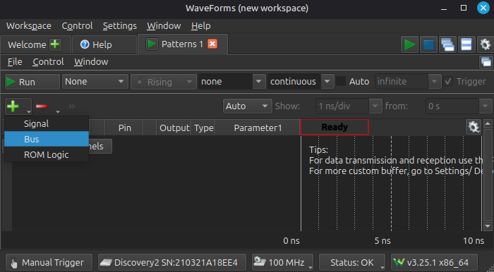

Now add DIO0-DIO3 to the "selected" column. You can do this by selecting DIO0, then holding shift and clicking DIO3, then clicking the plus icon.

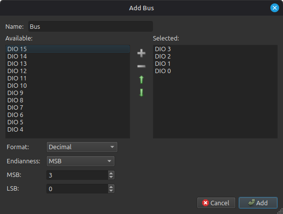

You should now see this:

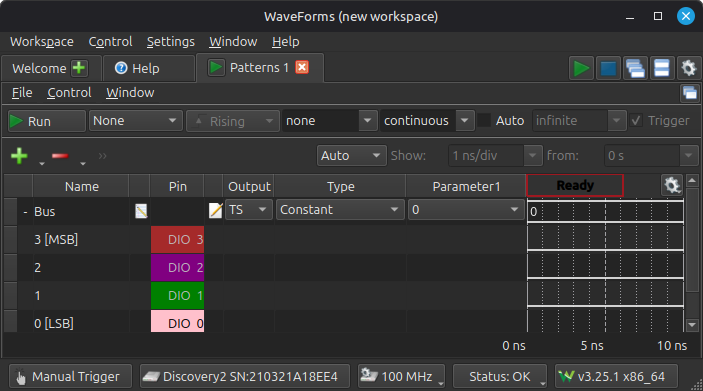

Under "Type" where it currently says "Constant", click and change it to "Binary Counter." It will default to 1kHz, but that is too fast. Change it to 6.4Hz. You can do this by typing "6.4 Hz" into the Parameter 1 field.

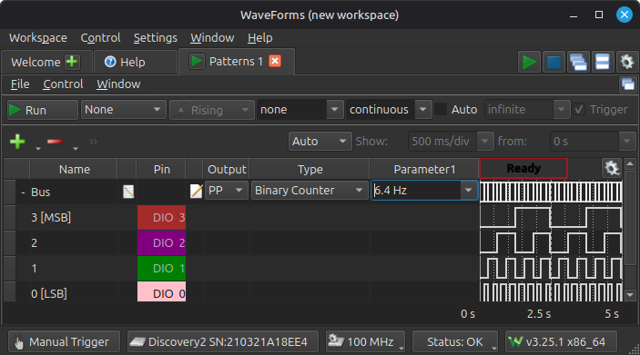

Now, if you click the run button, you should be able to see the counting pattern on `led[3:0]`, and the 7-segment display will change along with it, but don't worry about what is displayed on it.

### Logic Analyzer

We now want to be able to see `sw[3:0]` and `led[3:0]` as they change over time. Go back to the Welcome tab, and click "Logic." This will open the logic analyzer.

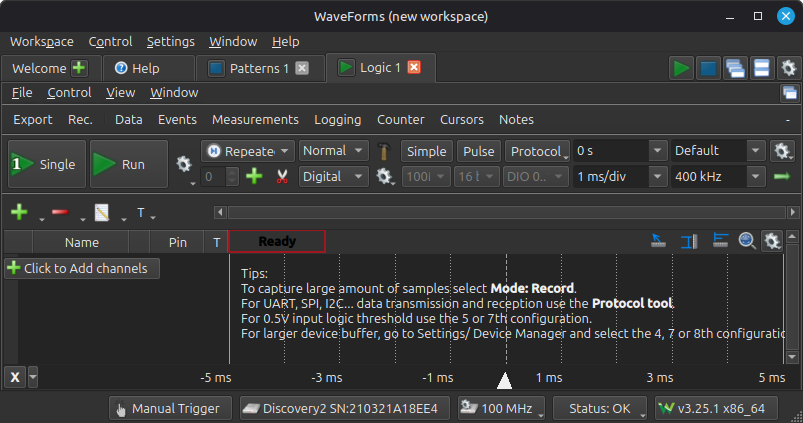

Just like how you did with the pattern generator, click the plus, select "Bus," and add DIO0-DIO3 to the bus. This will allow us to see the counter values.

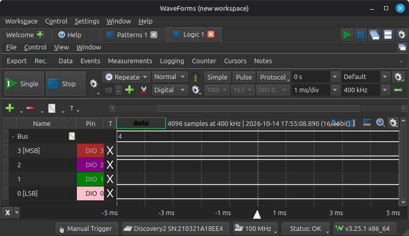

Right now, there are two things we need to fix. First, we need to zoom out to be able to see all the counter values from 0-15. Second, we need to collapse the bus view, so that we do not see the individual DIO signals. We do not care about them. We only care about the 4-bit value.

There are two ways to adjust the zoom. One is to scroll with the mouse wheel or a two-finger touchpad gesture; the other is to adjust the time per division. Using the mouse wheel can be finicky, so just set the time per division to 300ms, as shown below.

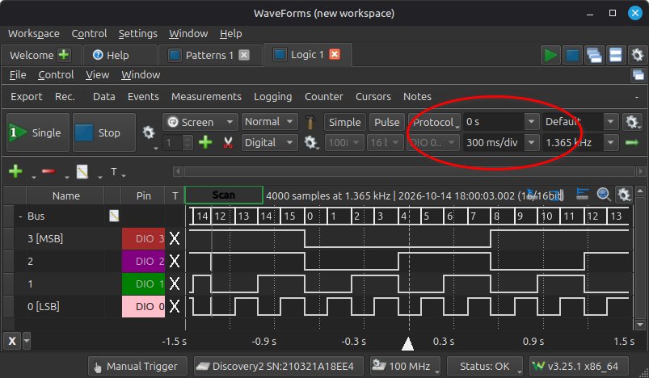

It will now start continuously scanning. This makes it hard to read, but can be fixed by adding a trigger. The trigger on a logic analyzer or oscilloscope is what determines where t=0 is. We want to set t=0 to be the point that the counter is outputting 0. We can do this by clicking the empty cell under the "T" column next to the label "Bus" and clicking "Enable protocol trigger" as shown below.

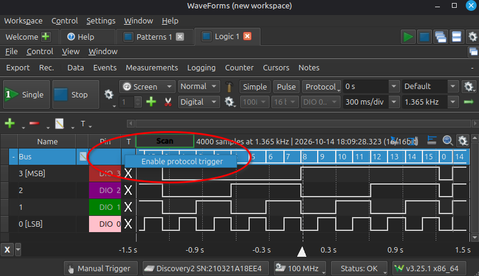

Now the blank cell should turn into an arrow. Click that to open the trigger menu, then just click OK, since it defaults to 0.

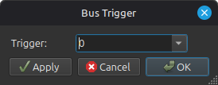

Because we are zoomed out so far, WaveForms still does not use the trigger by default. To fix this, click the drop-down menu that says "Screen" and change it to "Repeated."

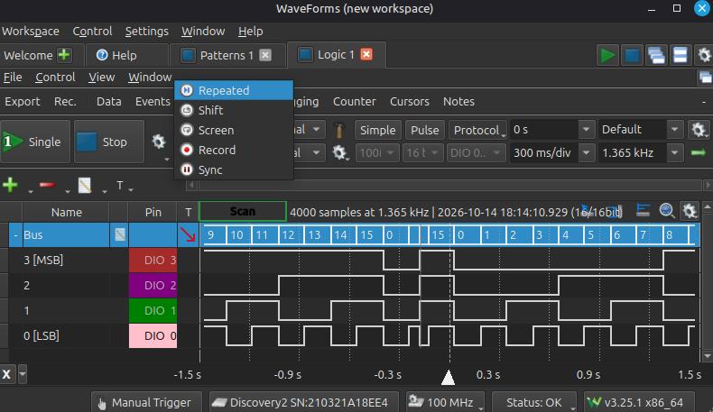

It will now stop scanning, and only update every few seconds. We now want to move t=0 so that it is on the left of the screen. This can be done either by clicking and dragging the triangle at t=0 over to the left, or by changing the value above where you set the time per division to 1.2s. Either one works.

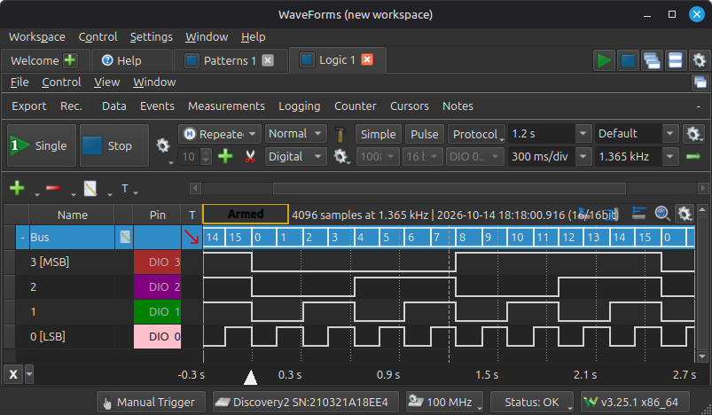

Now, to hide the individual signals, click the "-" next to "Bus."

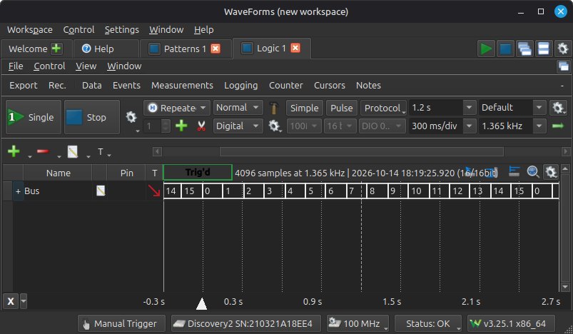

Now add another bus that shows DIO4-DIO7 and hide its individual signals as well. It will be slightly offset from the input bus, since it takes time to write to the shift register. The two buses will show the same signals for now. Pressing `btn[2]` will cause the output of the Enigma machine to appear on the second bus.

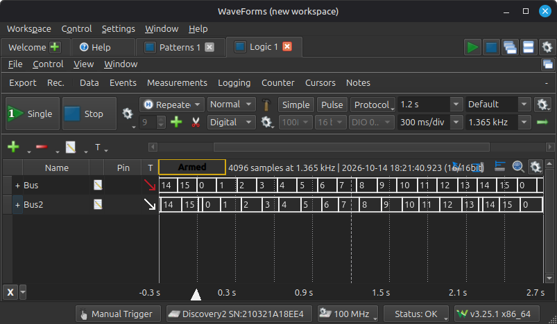

### Waveform Generator

We now need to provide the clock and reset signals. For this we will use the waveform generator. This will allow us to synchronize the reset with the input being 0, allowing a consistent output on the logic analyzer. Go back to the welcome tab and click "Wavegen."

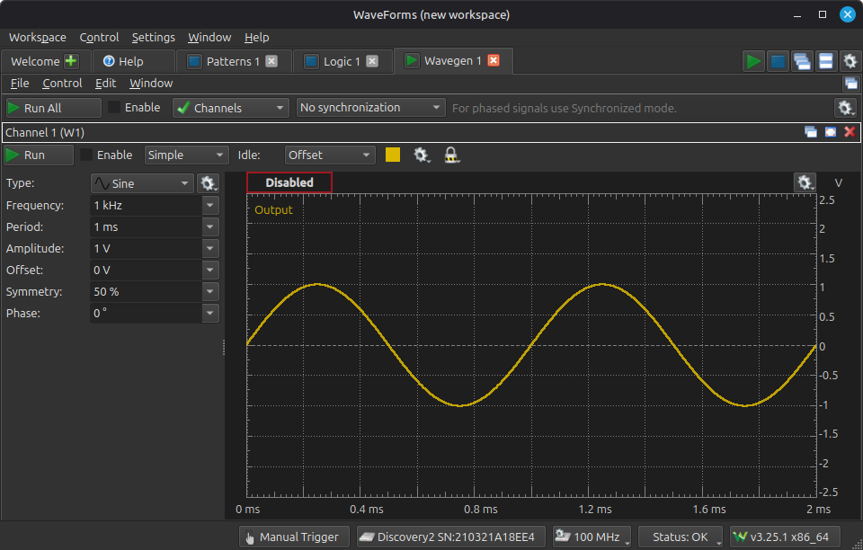

We will need both channels, so click the drop-down menu with the green check labeled "Channels" and check Channel 2.

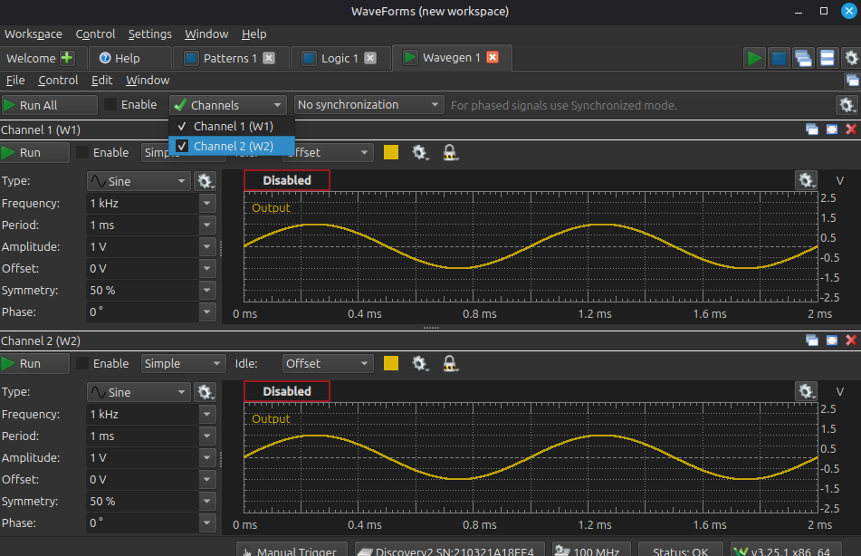

Now, for both, set the type to "Square," set the amplitude to 1.5V, and the offset to 1.5V. This will create a signal that oscillates between 0V and 3V.

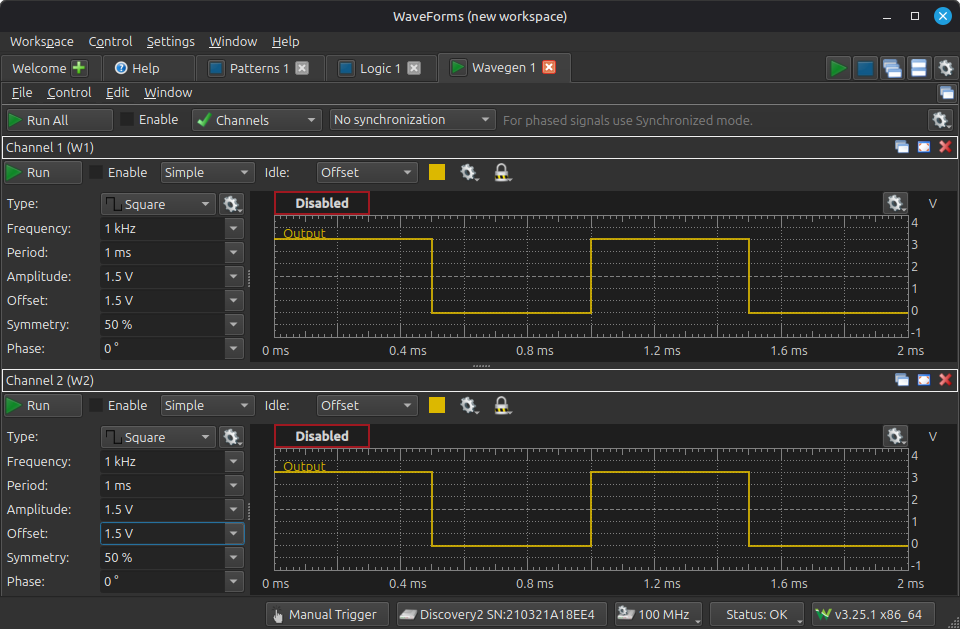

Channel 1 is going to be the reset signal. We only want it to be high for a short pulse at the beginning. We can achieve this by setting its "symmetry" to 1%. We only want it to pulse at the start of the counter sequence, so we need to make the frequency 1/16 of the 6.4Hz everything else is running at, so make its frequency 400mHz.

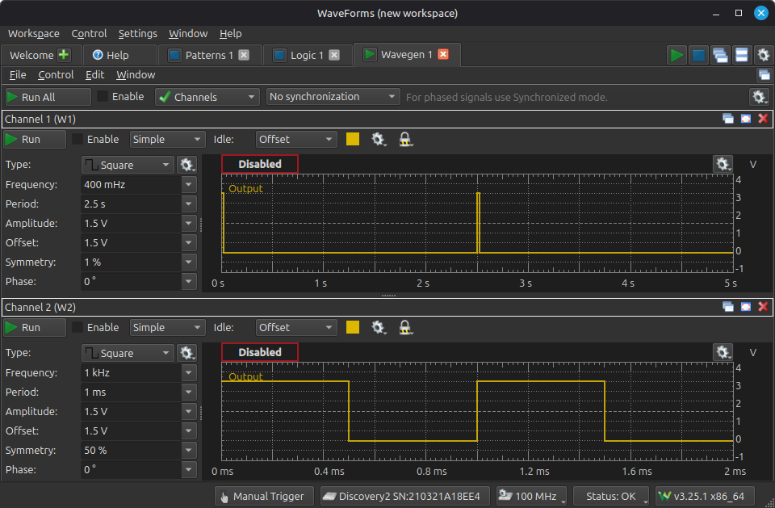

Channel 2 will be the clock, so all we need to do is set its frequency to 6.4Hz.

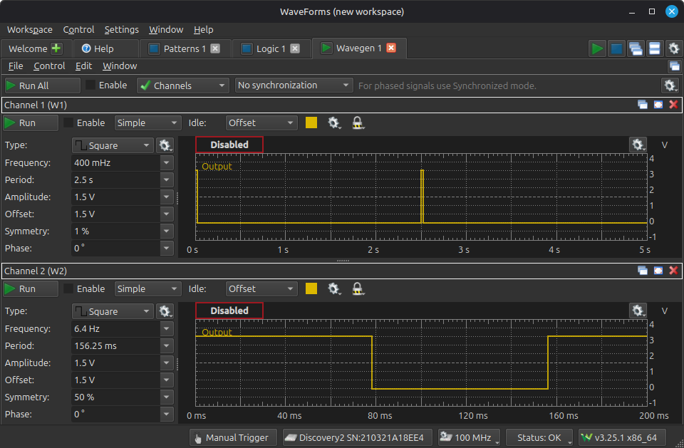

Now click the green play button at the top left that says "Run All." You should now see the key on `led[7:4]` changing.

### Synchronizing

The last thing we need to do is synchronize the pattern generator with the reset signal. To do this, go back to the pattern generator tab, and where it says "Trigger" click the drop-down menu that defaults to "None" and select "Wavegen C1."

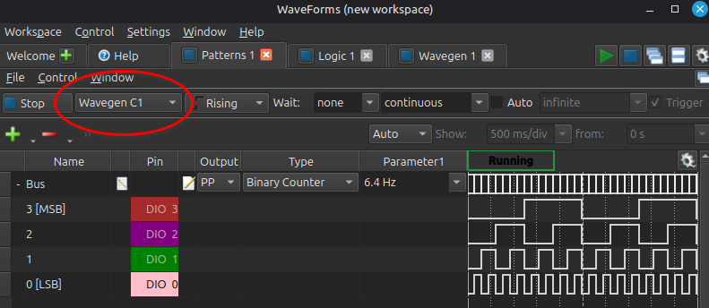

**Now you need to click stop, and then click run again on the pattern generator.** This will make it start counting from 0 the first time it sees a rising edge on W1.

Now, if you go to the logic analyzer, and hold down `btn[2]`, you will see the plain text input on the first bus, and the cipher text output on the second bus. There will be some small glitches that show up due to the time it takes for the shift register to update, but that is okay. The image below shows what it should look like if you have `sw[7:4]` all turned OFF.

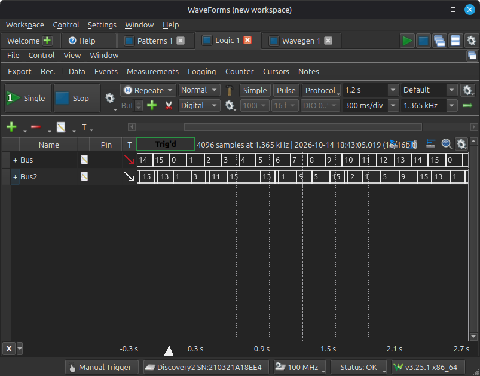

## Demo Procedure

1. Instructor or TA will hold `btn[3]` and toggle all switches to confirm they work.

2. Instructor or TA will confirm that the 7-segment display is functioning correctly.

3. All switches will be placed in the OFF position.

4. Pattern generator, waveform generator, and logic analyzer will be enabled, as described in the previous section.

5. Instructor or TA will set `sw[7:4]` to a specific value, to modify the seed.

6. Instructor or TA will observe the inputs on the logic analyzer, and confirm that they are shown on `led[3:0]`.

7. Instructor or TA will hold `btn[2]` to display the cipher text on `led[3:0]` and confirm that the output is correct.

## Rubric

**If you do not at least attempt the Analog Discovery demo, the highest grade you can receive for the project is a 50. You must bring an Analog Discovery to the demo and try to set it up to only lose 15 points for it not working. I will try to help you get it working.**

| Category | Tests | Points |
| --- | --- | --- |
| `negate` | 1.0 – 1.2 (2 pts each) | 6 |
| `sbox` | 2.0 – 2.2 (2 pts each) | 6 |
| `xorshift798` | 3.0 – 3.3 (3 pts each) | 12 |
| `ones_comp_add` | 4.0 – 4.2 (2 pts each) | 6 |
| `enigma` | 5.0 – 5.4 (3 pts each) | 15 |
| `sevseg_disp` | 6.0 – 6.2 (2 pts each) | 6 |
| `swap` | 7.0 – 7.2 (2 pts each) | 6 |
| `main` | 8.0 – 8.4 (3, 3, 2, 2, 3 pts) | 13 |
| **Verilog total** | | **70** |
| Circuit demo | Demonstrate the working circuit | 15 |
| Analog Discovery demo | Demonstrate testing the circuit with the Analog Discovery | 15 |
| **Total** | | **100** |